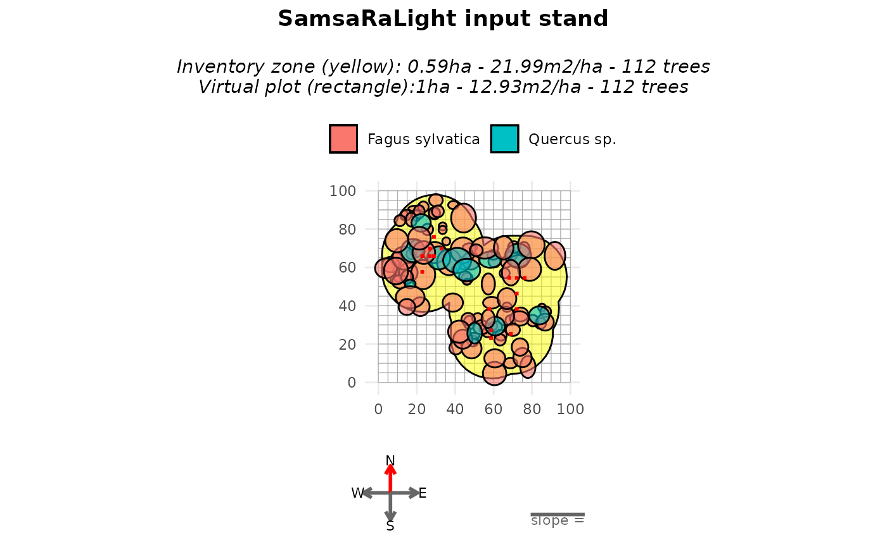
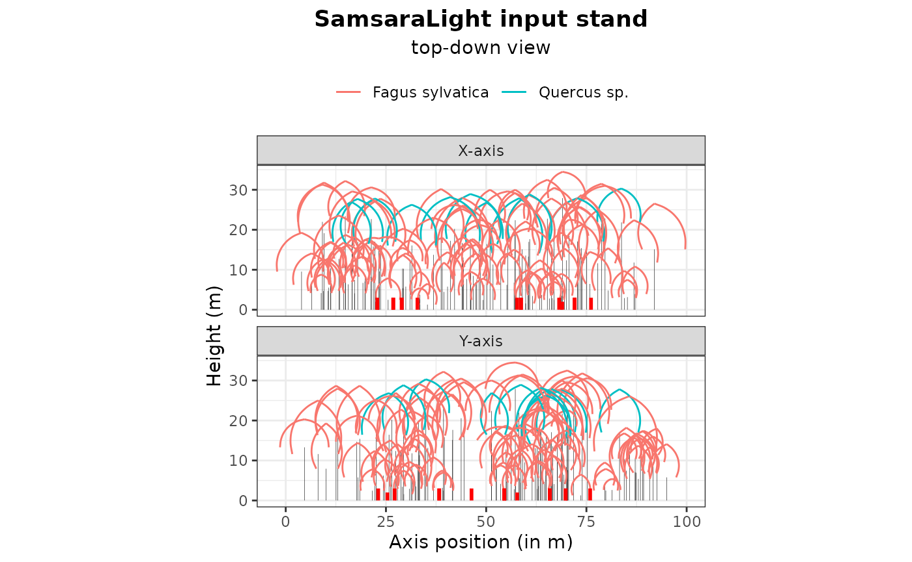
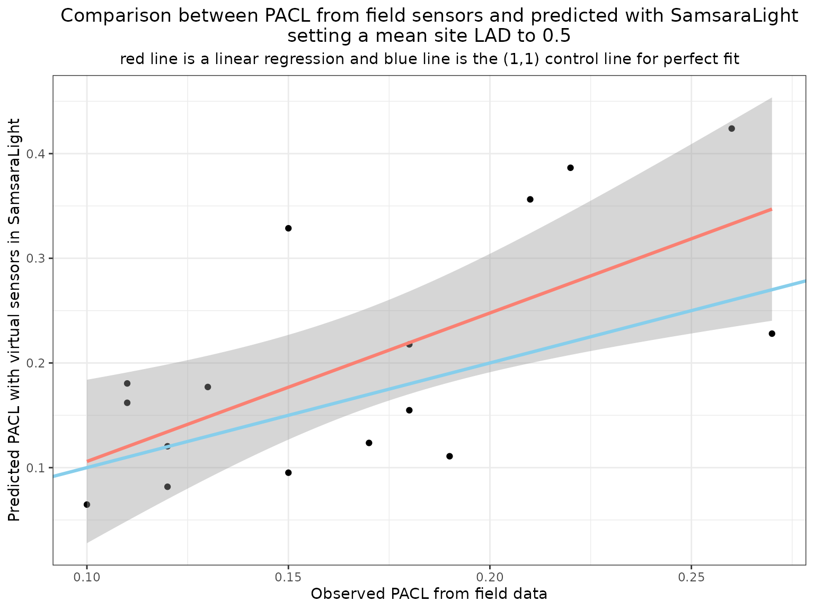

# Implement virtual sensors

``` r

library(SamsaRaLight)
library(dplyr)
library(ggplot2)
library(grid)
```

## Introduction

Virtual sensors allow us to estimate the amount of radiation reaching
specific locations in the stand, such as the forest floor. In this
vignette, we show how to define and use virtual sensors in SamsaRaLight,
and how sensor outputs can be compared with field measurements of
percentage of above canopy light (PACL).

## Measuring light in the field

In forest ecosystems, light availability at the ground level can be
measured using direct sensors (quantum sensors, dataloggers) or indirect
methods such as hemispherical photography. These measurements provide
estimates of transmitted radiation or PACL at specific locations. In
SamsaRaLight, virtual sensors are designed to reproduce such
measurements within simulated stands.

## Defining sensors in a virtual stand

In the model, a sensor represents a point where incoming radiation is
recorded. Sensors are defined by their spatial coordinates and height
over the ground and are provided as a dedicated data.frame when creating
the stand. Measurements of PACL are not required as input data for the
model, only `id_sensor`, `x`, `y` and `h_m` variables.

The following example shows the sensor configuration used in the
`cloture20` dataset.

``` r

SamsaRaLight::data_cloture20$sensors
#>    id_sensor     x     y h_m pacl pacl_direct pacl_diffuse
#> 1          1 22.00 56.64   2 0.11        0.13         0.10
#> 2          2 71.22 53.45   3 0.22        0.28         0.16
#> 3          3 75.30 53.45   3 0.26        0.31         0.21
#> 4          4 71.22 45.27   3 0.15        0.13         0.16
#> 5          5 71.22 37.21   3 0.13        0.08         0.17
#> 6          6 56.88 37.21   3 0.18        0.12         0.22
#> 7          7 68.11 24.30   2 0.27        0.29         0.24
#> 8          8 57.84 22.00   3 0.18        0.21         0.15
#> 9          9 57.84 26.11   3 0.10        0.12         0.09
#> 10        10 67.34 53.45   3 0.21        0.26         0.17
#> 11        11 22.00 64.82   3 0.17        0.20         0.15
#> 12        12 25.97 64.82   3 0.19        0.24         0.15
#> 13        13 25.97 68.74   3 0.12        0.09         0.14
#> 14        14 28.08 74.86   3 0.11        0.03         0.18
#> 15        15 32.00 68.74   3 0.12        0.07         0.17
#> 16        16 28.08 64.82   3 0.15        0.18         0.13
```

An input sensors data.frame structure can be checked using the function
[`SamsaRaLight::check_sensors()`](https://natheob.github.io/SamsaRaLight/reference/check_sensors.md)

``` r

SamsaRaLight::check_sensors(SamsaRaLight::data_cloture20$sensors)
#> Sensors table successfully validated.
```

Sensors are included in the stand definition using the `sensors`
argument of
[`create_sl_stand()`](https://natheob.github.io/SamsaRaLight/reference/create_sl_stand.md).

``` r

stand_cloture <- SamsaRaLight::create_sl_stand(
  
  # Tree inventory
  trees_inv = SamsaRaLight::data_cloture20$trees,
  core_polygon_df = SamsaRaLight::data_cloture20$core_polygon,
  
  # STand geometry
  cell_size = 5,
  latitude = SamsaRaLight::data_cloture20$info$latitude,
  slope = SamsaRaLight::data_cloture20$info$slope,
  aspect = SamsaRaLight::data_cloture20$info$aspect,
  north2x = SamsaRaLight::data_cloture20$info$north2x,
  
  # Define sensors
  sensors = SamsaRaLight::data_cloture20$sensors
) 
#> SamsaRaLight stand successfully created.
```

Once the stand is created, their presence can be checked by printing or
plotting the object. Sensors appear as red symbols in the graphical
outputs and can be hidden if needed (`add_sensors = F` argument).

``` r

print(stand_cloture)
#> SamsaRaLight stand of 1 ha with 112 trees and 16 sensors (20 x 20 cells, 5 m)

plot(stand_cloture)
```



``` r

plot(stand_cloture, top_down = TRUE)
```



## Obtaining sensor outputs

After defining the sensors, the model is run in the usual way. When only
sensor outputs are required, the argument `sensors_only = TRUE` can be
used to reduce computation time. In this example, we compute the full
output for illustration purposes.

``` r

out_cloture <- SamsaRaLight::run_sl(
  sl_stand = stand_cloture,
  monthly_radiations = SamsaRaLight::data_cloture20$radiations,
  
  detailed_output = TRUE,
  sensors_only = FALSE
)
#> parallel mode: DISABLED | Threads = 1 (user) | Cores available = 4
#> SamsaRaLight simulation was run successfully.
```

Sensor-level results are stored following the same structure as cell
outputs and include total, direct, and diffuse components when
`detailed_output = TRUE`. Unlike cells, sensor energy is computed on a
horizontal plane, which makes it directly comparable with most field
measurements.

``` r

out_cloture$output$light$sensors
#>    id_sensor         e  e_direct e_diffuse       pacl pacl_direct pacl_diffuse
#> 1          1  609.3195 304.55761  304.7619 0.16194498  0.17724632   0.14908351
#> 2          2 1454.1585 715.98168  738.1768 0.38648633  0.41668674   0.36110152
#> 3          3 1595.1457 787.94787  807.1978 0.42395791  0.45856960   0.39486522
#> 4          4 1236.6495 401.38048  835.2691 0.32867679  0.23359526   0.40859712
#> 5          5  666.1820 161.89761  504.2843 0.17705788  0.09422111   0.24668594
#> 6          6  582.5560 125.78588  456.7702 0.15483178  0.07320482   0.22344294
#> 7          7  857.9372 405.53173  452.4055 0.22802260  0.23601120   0.22130782
#> 8          8  819.2502 395.38544  423.8648 0.21774038  0.23010626   0.20734629
#> 9          9  243.4726 126.02466  117.4479 0.06471015  0.07334378   0.05745319
#> 10        10 1340.5660 679.13846  661.4276 0.35629571  0.39524474   0.32355729
#> 11        11  465.1089 285.54406  179.5648 0.12361667  0.16618082   0.08783957
#> 12        12  417.2254 258.10991  159.1155 0.11089018  0.15021471   0.07783614
#> 13        13  307.5456  59.71210  247.8335 0.08173948  0.03475122   0.12123524
#> 14        14  678.9267  61.95883  616.9679 0.18044519  0.03605878   0.30180851
#> 15        15  453.0699  79.13148  373.9384 0.12041693  0.04605291   0.18292327
#> 16        16  358.0726 207.29314  150.7795 0.09516856  0.12064038   0.07375835
#>        punobs punobs_direct punobs_diffuse
#> 1  0.57858969     0.6615636      0.4956714
#> 2  0.82066390     0.8240502      0.8173794
#> 3  0.85491722     0.8624839      0.8475310
#> 4  0.78626960     0.6536315      0.8500076
#> 5  0.58516209     0.2559043      0.6908684
#> 6  0.67356400     0.2698019      0.7847525
#> 7  0.76252495     0.7483858      0.7751991
#> 8  0.70745927     0.7075349      0.7073887
#> 9  0.08088008     0.0000000      0.1676665
#> 10 0.81434506     0.8190368      0.8095277
#> 11 0.30610837     0.3172534      0.2883855
#> 12 0.35778962     0.3670988      0.3426887
#> 13 0.50362775     0.4510258      0.5163015
#> 14 0.82400017     0.5643760      0.8500729
#> 15 0.75229301     0.6706714      0.7695655
#> 16 0.34758000     0.3791526      0.3041737
```

## Comparing observed and simulated PACL

We can now compare simulated PACL values with field measurements
collected at the sensor locations. The following figure shows the
relationship between observed and predicted PACL for an initial LAD
value of 0.5. When predictions are systematically higher than
observations, the model simulates too much transmitted light. This
indicates that foliage density is underestimated and that LAD should be
increased. Conversely, systematic underestimation would suggest
excessive attenuation.

``` r

dplyr::left_join(
  
  SamsaRaLight::data_cloture20$sensors %>% 
    dplyr::select(id_sensor, pacl) %>% 
    dplyr::rename_at(vars(-"id_sensor"), ~paste0(., "_obs")),
  
  out_cloture$output$light$sensors %>% 
    dplyr::select(id_sensor, pacl) %>% 
    dplyr::rename_at(vars(-"id_sensor"), ~paste0(., "_pred")),
  
  by = "id_sensor"
) %>% 
  
  dplyr::mutate(
    diff_pacl = pacl_obs - pacl_pred
  ) %>% 
  
  ggplot(aes(y = pacl_pred, x = pacl_obs)) +
  geom_point() +
  geom_smooth(method = "lm", formula = y ~ x, color = "salmon", linewidth = 1.1) +
  geom_abline(intercept = 0, slope = 1, color = "skyblue", linewidth = 1.1) +
  xlab("Observed PACL from field data") +
  ylab("Predicted PACL with virtual sensors in SamsaraLight") +
  labs(title = "Comparison between PACL from field sensors and predicted with SamsaraLight\nsetting a mean site LAD to 0.5",
       subtitle = "red line is a linear regression and blue line is the (1,1) control line for perfect fit") +
  theme_bw() +
  theme(plot.title = element_text(hjust = 0.5),
        plot.subtitle = element_text(hjust = 0.5))
```



In this example, PACL is on average overestimated, suggesting that the
default LAD value of 0.5 is slightly too low.
